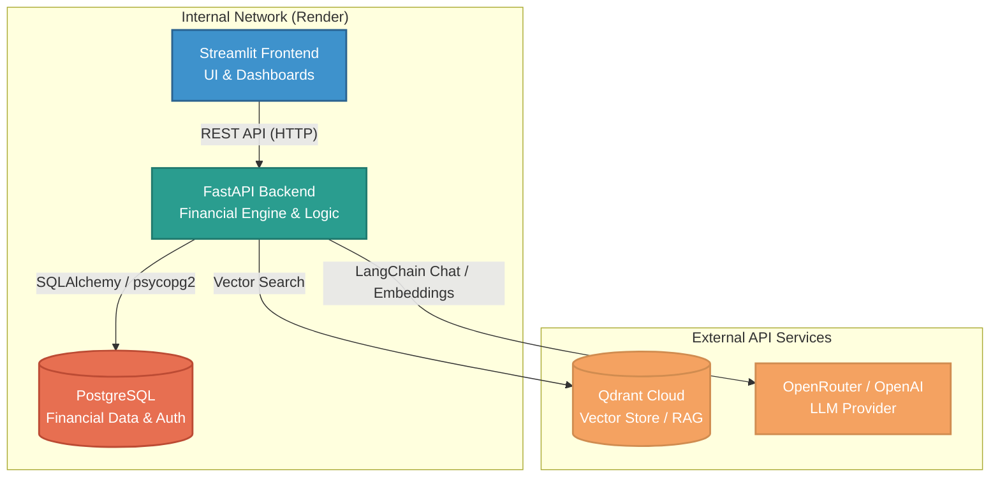

# FinSight — AI-Powered FP&A & Financial Analytics Platform

> FastAPI · Streamlit · PostgreSQL · Qdrant · LangChain · Docker · Render

FinSight is a full-stack FP&A platform that ingests raw actuals and budget data, computes verified financial metrics in Python, performs budget-vs-actual variance analysis with driver attribution, forecasts future performance, supports what-if scenario planning, exposes a grounded AI Finance Analyst for Q&A and commentary, and produces automated Excel/PDF/PowerPoint management reports.

---

## System Architecture


The platform uses a decoupled, service-oriented architecture designed for deployment on modern PaaS providers (like Render).



### Component Breakdown

1. **Frontend (Streamlit):** A stateless Python web application. It handles all data visualization using Plotly, file uploads, and user interactions. It communicates exclusively via REST API to the backend and never connects to the database directly.
2. **Backend (FastAPI):** The core intelligence of the platform. It handles all data validation (Pydantic), financial calculations, forecasting algorithms (scikit-learn), scenario generation, and report generation (Excel/PDF/PPTX).
3. **Database (PostgreSQL):** The source of truth for all structured data. It stores users, raw uploads (actuals/budget), calculated variance outputs, and audit trails.
4. **Vector Store (Qdrant):** Stores vector embeddings of generated "Fact Documents" (textual summaries of the financial data) for use in the RAG pipeline. Namespaced by `analysis_run_id` to ensure strict data isolation between runs.
5. **LLM Engine (LangChain/OpenRouter):** Powers the AI Analyst.

**Core architectural principle:** Python performs *all* financial arithmetic. The LLM only ever reads and explains already-computed, verified numbers fetched via vector search — it never calculates financial metrics itself. This prevents hallucination of financial data.

---

## Quick Start (Local)

### Prerequisites
- Docker & Docker Compose
- (Optional) Python 3.11+ for running scripts locally

### 1 — Clone & configure
```bash
git clone <repo-url>
cd finsight
cp .env.example .env
# Edit .env — set DATABASE_URL to your Supabase Postgres URI,
# then fill OPENROUTER_API_KEY (or OPENAI_API_KEY) and QDRANT_URL/QDRANT_API_KEY.
```

### 2 — Start the stack
```bash
docker-compose up --build
```

This starts two core services:
| Service | Port | Description |
|---------|------|-------------|
| `backend` | 8000 | FastAPI + Uvicorn (hot-reload) |
| `frontend` | 8501 | Streamlit UI |

If you want a local Postgres fallback instead of Supabase:
```bash
docker-compose --profile local-db up --build
```

### 3 — Verify

```bash
# Backend health check
curl http://localhost:8000/health
# → {"status":"ok"}

# API docs
open http://localhost:8000/docs

# Streamlit UI
open http://localhost:8501
```

### 4 — Run Alembic migrations
```bash
docker-compose exec backend alembic upgrade head
```

### 5 — Generate synthetic dataset
```bash
docker-compose exec backend python /app/../data/synthetic/generate_dataset.py
# Produces data/synthetic/actuals.xlsx and budget.xlsx
```

---

## Project Structure

```
finsight/
├── backend/
│   ├── app/
│   │   ├── main.py                 # FastAPI entrypoint + /health
│   │   ├── config.py               # pydantic-settings (reads .env)
│   │   ├── db/
│   │   │   ├── base.py             # SQLAlchemy DeclarativeBase
│   │   │   ├── session.py          # engine + get_db() dependency
│   │   │   └── models.py           # all 8 table models (§6)
│   │   ├── schemas/                # Pydantic request/response models
│   │   ├── api/
│   │   │   ├── routes_uploads.py   # POST /uploads/* (Phase 1)
│   │   │   ├── routes_financials.py# GET /financials/* (Phase 1)
│   │   │   ├── routes_forecast.py  # POST /forecast/run (Phase 3)
│   │   │   ├── routes_scenarios.py # POST /scenarios (Phase 4)
│   │   │   ├── routes_ai.py        # POST /ai/ask, /ai/commentary (Phase 5)
│   │   │   ├── routes_reports.py   # POST /reports/generate (Phase 6)
│   │   │   └── routes_audit.py     # GET /audit/runs (Phase 7)
│   │   ├── services/
│   │   │   ├── ingestion.py        # validation & cleaning (Phase 1)
│   │   │   ├── financial_engine.py # P&L, margins, EBITDA (Phase 1)
│   │   │   ├── variance_engine.py  # variance + drivers (Phase 1/2)
│   │   │   ├── forecasting.py      # MA, regression, smoothing (Phase 3)
│   │   │   ├── scenario_engine.py  # scenario planning (Phase 4)
│   │   │   ├── rag_pipeline.py     # embeddings, retrieval (Phase 5)
│   │   │   └── reporting.py        # excel/pdf/pptx (Phase 6)
│   │   └── core/
│   │       ├── security.py         # JWT auth (Phase 7)
│   │       └── logging.py          # structured logging (Phase 7)
│   ├── alembic/                    # Alembic migrations (Phase 1)
│   ├── tests/                      # pytest suites
│   ├── Dockerfile
│   └── requirements.txt
├── frontend/
│   ├── app.py                      # Streamlit home
│   ├── pages/
│   │   ├── 1_Upload.py             # (Phase 1)
│   │   ├── 2_Dashboard.py          # (Phase 1)
│   │   ├── 3_Variance_Drivers.py   # (Phase 2)
│   │   ├── 4_Drilldown.py          # (Phase 2)
│   │   ├── 5_Forecast.py           # (Phase 3)
│   │   ├── 6_Scenarios.py          # (Phase 4)
│   │   ├── 7_AI_Analyst.py         # (Phase 5)
│   │   └── 8_Reports.py            # (Phase 6)
│   ├── api_client.py               # thin HTTP wrapper (Phase 1)
│   ├── Dockerfile
│   └── requirements.txt
├── data/
│   └── synthetic/
│       └── generate_dataset.py     # 30-month NovaTech dataset (Phase 1)
├── docker-compose.yml
├── .env.example
└── README.md
```

---

## Running Tests

```bash
docker-compose exec backend pytest backend/tests/ -v --cov=app
```

---

## Deployment (Render)

For production, keep `DATABASE_URL` pointed to Supabase and run:
```bash
alembic upgrade head
```
against that Supabase database before the first backend deploy.

---

## Tech Stack

| Layer | Technology |
|-------|-----------|
| Backend | FastAPI, Uvicorn |
| ORM | SQLAlchemy 2.0, Alembic |
| Database | PostgreSQL 16 |
| Data Processing | Pandas, NumPy |
| Forecasting | scikit-learn, statsmodels |
| AI / RAG | LangChain, Qdrant, OpenRouter / OpenAI |
| Reporting | openpyxl, ReportLab, python-pptx |
| Frontend | Streamlit, Plotly |
| Auth | passlib, python-jose (JWT) |
| Background Jobs | Celery, Redis (Phase 7) |
| Containerization | Docker, docker-compose |
| CI/CD | GitHub Actions |
| Deployment | Render (Backend + Frontend as separate web services) |
